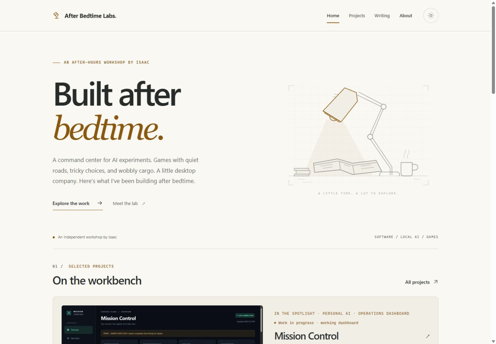
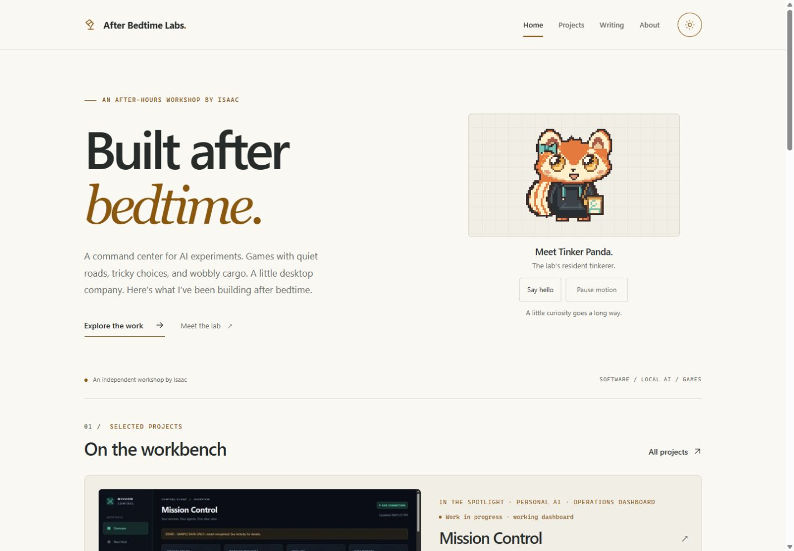
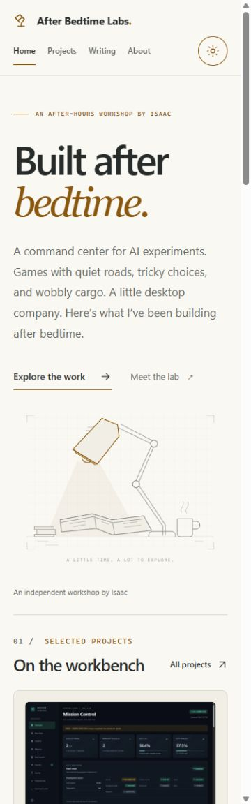
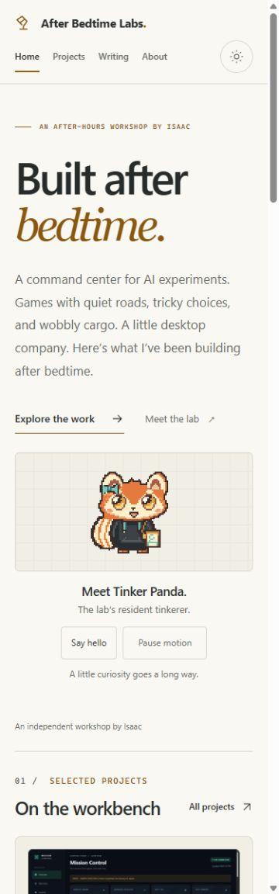
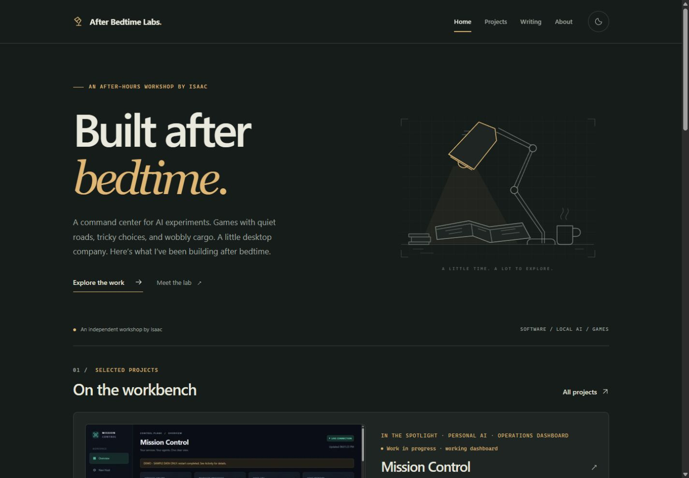
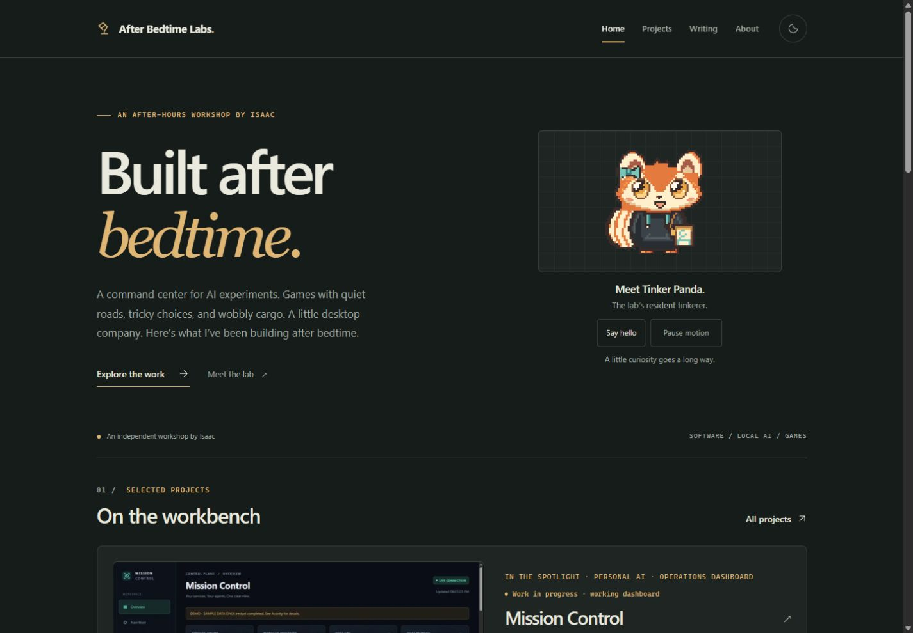
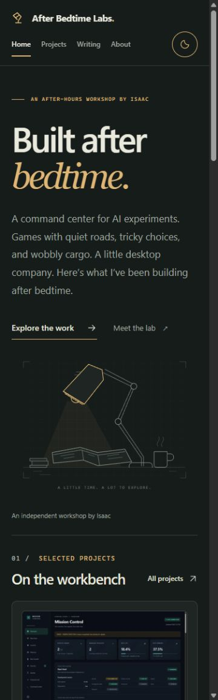
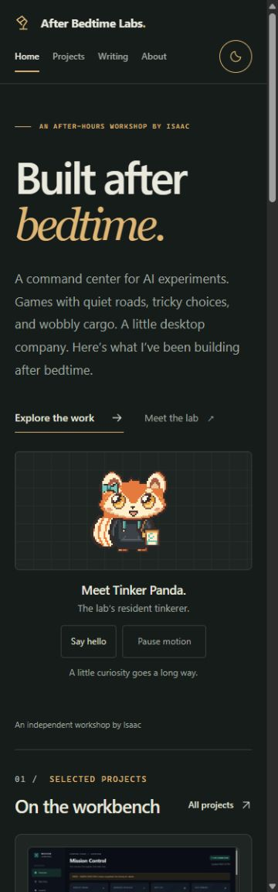

# Tinker Panda homepage integration V1

Status: draft for owner review. No merge or deployment performed.

## Scope and recovery

- Baseline: current `origin/main` at `05431e62db6077c302c265a7a7ede0410c0e72d6`, containing merged project showcase PR #4.
- Review branch: `codex/tinker-panda-homepage-v1`, in a new managed worktree. Existing checkouts, untracked `.codex/` and `.recovery/` material, and branches were preserved.
- Approved asset source: [PR #3](https://github.com/afterbedtimelabs/afterbedtimelabs.github.io/pull/3), `codex/tinker-panda-v2-1-production`, commit `824ecaa4b42c0a6797059a5dbd716e9b8548e0fa`.
- The reported prototype was verified in the separate recovered repository worktree `.recovery/living-workshop-v2`: branch `feature/living-workshop-v2`, exact HEAD `6862a4b16bef428fe514c575032410dfbb044936`. These objects were absent from the primary repository. Its finite animation, cancellation, and visibility patterns informed this component; its broad redesign was not copied. Its own notes reported no successful browser validation.
- Only the homepage illustration import/render and its tablet spacing change in existing application files. New code is scoped to `TinkerPanda.astro`. All original hero copy, project introductions, Mission Control priority, writing, navigation, and branding are retained. No dependency, global stylesheet, privacy/OAuth, favicon, logo, or deployment changes.

## Artwork and behavior

Four existing PNGs are copied without alteration from PR #3 into `public/mascot/tinker-panda-v2.1/`: `front.png` and the `idle`, `blink`, and `happy` atlases. Total: 6,888 bytes. No assets were generated or redesigned. Side, back, portrait, tail, curious, and sleepy artwork are not included.

The approved front SHA-256 is `a07781439461bc715463a6d830598e8eb93ef47ec508d346307d71915f534ba3`. The controller verification script pins all four source hashes.

The mascot uses a fixed 192px pixel grid on desktop and 128px on small screens. An idle or blink sequence plays once after 7.5 seconds of stillness; another still interval follows. Say hello produces a short text greeting and one happy sequence. Native controls provide visible focus, 44px targets, and a pause state. The greeting is announced through a polite live region.

Paused and reduced-motion greetings retain the approved static front. Motion stops when offscreen, the document is hidden, or the page is left. Pending image loads cannot restart canceled playback. Animation atlases load on demand and are cached; a failed atlas keeps the static image. Without JavaScript, the descriptive image and caption remain, and controls stay hidden. CSS also hides the animated sprite when `prefers-reduced-motion: reduce` matches.

## Validation performed on 2026-10-24

| Command/check | Result |
| --- | --- |
| `npm ci` | Completed using existing lockfile; no dependency changes. Existing audit findings recorded below. |
| `npm run validate` | Passed Astro check, production build, and production-output verification. 23 routed pages / 24 HTML documents including redirect; local links, fragments, assets, metadata, sitemap, RSS, robots, and draft exclusion pass. |
| `npm run check` after validation-harness cleanup | 31 files; zero errors, warnings, or hints. |
| `node scripts/verify-tinker-controller.cjs` | Four asset hashes match; 11/11 controller scenarios pass. |
| `git diff --check` | Passed. |
| Local HTTP requests to built pages/assets | 43 checked URLs returned HTTP 200, including all four Panda PNGs. |

Real in-app Chromium browser checks used the production build served over loopback, separately from a saved current-main baseline:

- 375x1200, 768x1024, and 1440x1000 CSS viewports in light and dark appearance; screenshots captured and inspected. Also checked 320px for horizontal overflow. No horizontal overflow at these widths.
- Browser inspection found the inherited negative illustration margin crowded the paragraph at tablet width. The final homepage uses a 24px gap and bounded grid columns; the recheck confirms a 24px separation.
- All visible Panda/project images loaded. Lower project images loaded when scrolled into view. Panda alt text identifies its name and appearance; decorative project thumbnail alt conventions are unchanged.
- Keyboard Tab reaches the skip link with a visible focus ring; Enter moves focus to main. Subsequent Tab reaches the greeting. Enter greets, and Space pauses. Paused greetings update text with the static front intact.
- Actual finite blink and idle frames were observed in timed browser sampling; Enter triggered `happy:0`. Pause and leaving the hero restore `front`. Explore the work reaches the project heading; Meet Mission Control opens its existing introduction.
- No warning/error console entries on the integration preview during the normal-page checks.
- A separate local preview served the same production output with `script-src 'none'`. The front PNG loaded, controls remained hidden, and the static homepage remained usable. Expected CSP-block messages in that fallback preview are intentional.

The controller tests transpile the actual component script with the existing TypeScript dependency and execute it in Node VM with deterministic DOM, timer, media-query, visibility, and image-load substitutes. They cover reduced motion at initialization and during a pending load; user pause persistence; failed atlases; repeated greetings; exact sequence timings; one active timer; offscreen/background cancellation; page restoration; and missing IntersectionObserver.

The built Panda controller is 2,327 bytes uncompressed (1,138 bytes gzip estimate). The four PNGs total 6,888 bytes. There is no framework hydration, animation library, perpetual animation-frame loop, or layout animation. No Lighthouse or field-performance score is claimed.

## Screenshots

These are unedited browser captures. Viewport sizes above are CSS dimensions verified in the page; the capture surface excludes the scrollbar and scales its JPEG output slightly.

| View | Before | After |
| --- | --- | --- |
| Desktop, light |  |  |
| Mobile, light |  |  |
| Desktop, dark |  |  |
| Mobile, dark |  |  |

Tablet: [light](screenshots/after-tablet-light.jpg), [dark](screenshots/after-tablet-dark.jpg). [Scripts-blocked fallback](screenshots/fallback-nojs.jpg).

## Remaining review and limitations

Only Candidate B's front master has prior owner visual approval. **The homepage placement, caption/greeting copy, controls, derived idle/blink/happy frames, and their playback timing have not received owner visual approval.** They are presented in this draft for that review. Side/back/portrait and other omitted art remain outside this integration and are not approved by it.

The available browser interface did not expose native reduced-motion emulation. Reduced-motion controller behavior was exercised with simulated media-query changes, and the CSS guard was source-reviewed; native OS/browser preference rendering still needs a manual check. Browser coverage is one desktop Chromium runtime with responsive viewports, not physical devices, Safari, or Firefox. Performance evidence is payload and scheduling inspection, not device profiling. Existing external social links were preserved; the automated HTTP check covered local URLs.

The unchanged lockfile's npm audit reported three transitive findings: `fast-uri` (moderate), `undici` (high), and `zod` (high). Dependency remediation is outside this integration.
